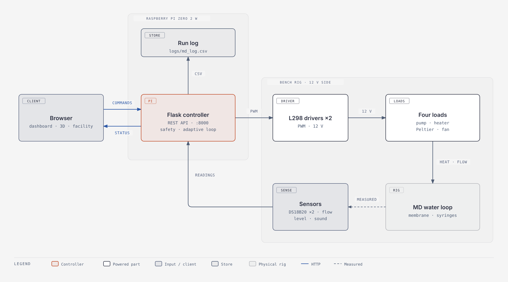
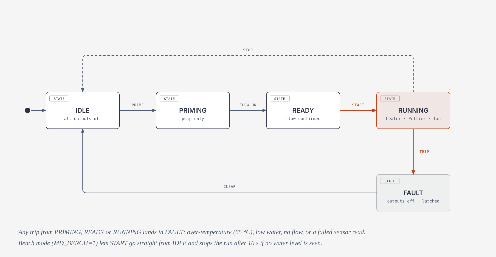
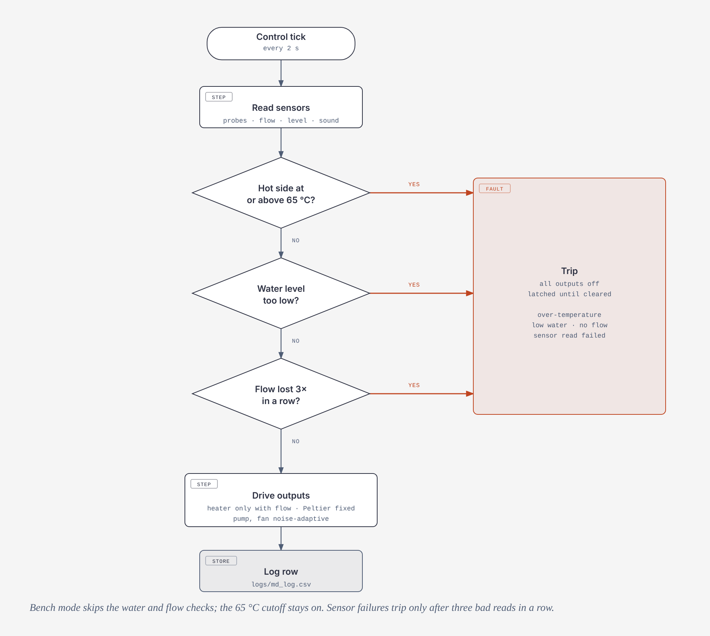

# NeuraVapour

**Recovering clean water from waste heat with membrane distillation, controlled by a Raspberry Pi.**

NeuraVapour is a laboratory-scale water-recovery rig. A power resistor stands in for the heat of a server rack and warms a water loop. A hydrophobic membrane lets only water vapour through. A Peltier-cooled chamber turns that vapour back into distilled water. A Raspberry Pi Zero 2 W runs the pump, heater, Peltier and fan, watches the sensors, enforces the safety limits, and serves a live dashboard plus two digital twins in the browser.

> **Where we are, honestly.** The controller, dashboard, both twins and the safety logic are built and tested in simulation and on the Pi. The rig is still being commissioned: the flow and level sensors are not yet giving trustworthy readings, and **we have not yet measured water yield**. Every scale-up number in the project is labelled *estimated* until we measure it. See [Commissioning status](#commissioning-status).

---

## Contents

1. [Why this project](#why-this-project)
2. [How it works](#how-it-works)
3. [System architecture](#system-architecture)
4. [Hardware](#hardware)
5. [Wiring and power](#wiring-and-power)
6. [Software layout](#software-layout)
7. [Install and run](#install-and-run)
8. [Run modes](#run-modes)
9. [Controller states](#controller-states)
10. [Safety interlocks](#safety-interlocks)
11. [Noise-adaptive control](#noise-adaptive-control)
12. [REST API](#rest-api)
13. [Configuration](#configuration)
14. [Dashboard and digital twins](#dashboard-and-digital-twins)
15. [Data logging](#data-logging)
16. [Testing order](#testing-order)
17. [Commissioning status](#commissioning-status)
18. [Troubleshooting](#troubleshooting)
19. [Research use and planned experiments](#research-use-and-planned-experiments)
20. [Limitations](#limitations)
21. [Roadmap](#roadmap)
22. [Credits and licences](#credits-and-licences)

---

## Why this project

Data centres reject heat, and many of them lose a lot of water to evaporative cooling and blow-down. Membrane distillation (MD) can run on low-grade heat, which is exactly what a liquid-cooled rack leaves over. We wanted a small, safe, repeatable rig that shows the whole chain, from rack heat to recovered water, and that we can instrument, log and explain.

Related work exists, and we build on it. Waste-heat MD for data-centre cooling water, Peltier-assisted MD modules, and data-centre digital twins have each been studied separately. What we add is a single low-cost bench that joins them, with a noise-adaptive controller, layered safety interlocks, a bench-commissioning mode, and two read-only digital twins that clearly separate real readings from simulated ones.

## How it works

**The physics.** In direct contact membrane distillation, hot water sits on one side of a hydrophobic membrane and cool water (or a cold surface) on the other. The vapour-pressure difference drives water vapour through the pores. It condenses on the cold side. The flux scales roughly as

```
J = C · (p_hot − p_cold)
```

where `C` is the membrane coefficient. Water vapour pressure is about 15.8 kPa at 55 °C and about 2.3 kPa at 20 °C, so a bigger temperature gap gives a bigger driving force.

**On our bench.**

| Real system | Our stand-in |
|---|---|
| Server rack heat | 10 Ω, 25 W power resistor on a heat sink |
| Liquid cooling loop | Small pump, tubing, water block |
| Membrane unit | Hot syringe and PTFE filter, vapour path to a cold syringe |
| Chiller | Peltier module with its own heat sink and fan |
| Facility instrumentation | DS18B20 probes, flow, level and sound sensors via an ADS1115 |
| Operations room | Flask dashboard, 3D twin, facility twin |

**Water and vapour path.** Pump → flow sensor → water block → hot syringe (in and out stubs) → pump inlet. Vapour leaves the hot syringe tip, passes a PTFE filter, and reaches a cold syringe resting on the Peltier cold face, where it condenses. Heat flows from the resistor through a heat sink and the water block into the water.

## System architecture



The Pi sits between two worlds. On one side it serves the browser clients over HTTP and keeps a run log. On the other side it reads the sensors and drives four loads through two L298-based drivers on a separate 12 V supply. All safety cutoffs run on the Pi itself, so they keep working if Wi-Fi drops.

## Hardware

| Part | Role | Notes |
|---|---|---|
| Raspberry Pi Zero 2 W | Controller | Powered from its own USB charger. The project docs were first written on a Pi 3 B+; the 40-pin GPIO map is the same |
| 2 × L298-based motor drivers | Switch the 12 V loads | `IN1` to 3.3 V, `IN2` to GND, `EN` carries the PWM |
| 12 V pump | Circulates the water loop | Kept at or above 40 % duty while running |
| 10 Ω, 25 W resistor | Heat source (rack stand-in) | At 12 V: up to 14.4 W at full duty, about 8.6 W at 0.6. Current build: one resistor |
| Peltier module (TEC-type) | Cold side | Capped at 30 % duty until its current is measured |
| 12 V fan | Cools the Peltier hot-side heat sink | |
| DS18B20 × 2 | Hot (water block) and cold-side temperature | 1-Wire on GPIO4 with a 4.7 kΩ pull-up |
| YF-S201 flow sensor | Loop flow | 7.5 pulses/s per L/min, about 1 to 30 L/min. Needs a 5 V → 3.3 V divider on the signal line |
| Water level sensor | Tank level | Analog, ADS1115 channel A1 |
| Sound sensor | Noise estimate | Analog, ADS1115 channel A0 |
| ADS1115 | 16-bit ADC on I²C | Address 0x48 |
| 2 × 12 V 3 A adapters | Power | One for the loads, one only for the resistor |

## Wiring and power

**Golden rule: the 12 V side never touches Pi GPIO.** All grounds join at one point (Pi, both 12 V supplies, both drivers, sensors).

**GPIO map (BCM)**

| Function | GPIO | Driver pin |
|---|---|---|
| Pump | 18 | Driver 1 ENA |
| Peltier | 13 | Driver 1 ENB |
| Heater (resistor) | 12 | Driver 2 ENA |
| Fan | 19 | Driver 2 ENB |
| Flow sensor (pulse in) | 17 | n/a |
| DS18B20 1-Wire | 4 | n/a |
| ADS1115 I²C | 2 (SDA), 3 (SCL) | n/a |

**Loads on the drivers**

| Driver terminals | Load |
|---|---|
| Driver 1 OUT1 / OUT2 | Pump |
| Driver 1 OUT3 / OUT4 | Peltier (polarity matters) |
| Driver 2 OUT1 / OUT2 | Resistor |
| Driver 2 OUT3 / OUT4 | Fan |

**Sensors**

- DS18B20: red to 3.3 V, black to GND, yellow to GPIO4, 4.7 kΩ between yellow and 3.3 V.
- Flow sensor: red to 5 V, black to GND, yellow to GPIO17 through a voltage divider.
- ADS1115: VDD to 3.3 V, GND to GND, SCL to GPIO3, SDA to GPIO2.
- Sound sensor: `+` to 3.3 V, `G` to GND, `AO` to ADS1115 A0.
- Level sensor: `+` to 3.3 V, `-` to GND, `S` to ADS1115 A1.
- Fit a 10 kΩ pull-down from each driver `EN` pin to GND so the heater and Peltier stay off while the Pi boots.

**Current limits (read before raising any duty)**

- An L298 channel is rated about 2 A and drops about 2 V, so loads see roughly 10 V, not 12 V.
- A TEC1-12706-class Peltier can draw 4 to 6 A. PWM lowers the average current but each on-pulse still carries the full current, so an L298 can still be overloaded. **Measure the real current first.** If it is above about 2 A, move the Peltier to a logic-level MOSFET module or a BTS7960 driver (it takes the same PWM signal from GPIO13) and use a larger supply. This is why `DUTY_MAX["peltier"]` is 0.3 by default.
- Resistor branch: keep `12 / R` under 2 A. A 10 Ω resistor draws 1.2 A, which is fine.
- Never run the Peltier for more than a few seconds without its hot-side heat sink and fan.

## Software layout

```
neuravapour/
├── md_chamber_control.py   Controller: safety, adaptive control, logging, Flask server
├── config.py               Every tunable value: probe ids, limits, duties, pins
├── projection.py           Scale-up estimate used by /api/projection
├── loader.html             NeuraVapour loader, then redirects to /dashboard
├── dashboard.html          2D live dashboard
├── twin.html               3D bench twin (Three.js)
├── facility.html           Facility twin: a data-centre hall with the bench rig inside
├── assets/                 theme.css (shared colours and fonts) and bundled fonts
├── vendor/                 Three.js copy so the 3D pages work offline
├── scripts/                Bench tests for each sensor and output
├── deploy/                 systemd service and install.sh
├── docs/                   SETUP, TESTING, WIRING, REMOTE, and diagrams/
└── logs/md_log.csv         Run log (created while running)
```

| URL | File | What it is |
|---|---|---|
| `/` | `loader.html` | Loader, then forwards to `/dashboard` |
| `/dashboard` | `dashboard.html` | 2D live dashboard |
| `/classic` | built into the controller | Minimal fallback page |
| `/twin` | `twin.html` | 3D bench twin |
| `/facility` | `facility.html` | Facility twin |

Colours, fonts, corner radius and paper grain for the dashboard and both twins (including the 3D scene) live in `assets/theme.css`. Fonts are bundled, so the pages work without internet.

## Install and run

### 1. Prepare the Pi

```bash
ssh <user>@<pi-ip>
sudo raspi-config            # Interface Options: enable I2C and 1-Wire, then reboot
sudo apt update
sudo apt install python3-pip python3-smbus i2c-tools python3-flask git -y
pip3 install adafruit-circuitpython-ads1x15 RPi.GPIO w1thermsensor gpiozero --break-system-packages
```

Check the ADC and probes:

```bash
sudo i2cdetect -y 1                                  # expect 48
ls /sys/bus/w1/devices/                              # expect one or two 28-... entries
cat /sys/bus/w1/devices/28-XXXXXXXXXXXX/w1_slave     # crc=... YES, t=31000 means 31.0 °C
```

Put the probe ids into `config.py` (`HOT_ID` for the water block, `COLD_ID` for the cold side).

### 2. Try it on a laptop first (fake hardware)

```bash
pip install flask
MD_SIMULATE=1 python3 md_chamber_control.py
```

Open `http://localhost:8000` and use the token `test`.

### 3. Run on the real rig

```bash
cd ~/neuravapour
source venv/bin/activate                 # if you use a virtual environment
MD_TOKEN=<your-token> python3 md_chamber_control.py
```

Use `tmux` so an SSH drop does not kill the program. `MD_TOKEN` is required; without it remote control is disabled (the API answers 503).

### 4. Start on boot (optional)

```bash
bash deploy/install.sh        # creates .env with a random token and enables the mdchamber service
journalctl -u mdchamber -f    # follow the logs
```

If you later run the program by hand, stop the service first so it does not hold the GPIO pins:

```bash
sudo systemctl stop mdchamber
sudo systemctl disable mdchamber
```

Remote access beyond your Wi-Fi: install Tailscale on the Pi and your phone, then open `http://<pi-tailscale-name>:8000`. Do not port-forward the Pi through your router. See `docs/REMOTE.md`.

## Run modes

| Mode | How to start | What it does |
|---|---|---|
| **Normal** | `MD_TOKEN=... python3 md_chamber_control.py` | All interlocks active: flow confirmation, water level, over-temperature, sensor validity |
| **Simulation** | `MD_SIMULATE=1 python3 md_chamber_control.py` | Fake hardware, token `test`. For laptops and demos |
| **Bench** | `MD_TOKEN=... MD_BENCH=1 python3 md_chamber_control.py` | For commissioning while the flow or level sensors are not yet working |

**Bench mode** skips the calibration check, flow confirmation, the no-flow fault and the water-level fault. It still needs the hot probe and still enforces the 65 °C cutoff. Start is manual, and if no water level is detected 10 s after Start, the run stops automatically and the dashboard shows a notice. Set `MD_BENCH_LEVEL=0` to skip that 10 s check. Never leave unattended hardware in bench mode.

**Environment variables**

| Variable | Default | Meaning |
|---|---|---|
| `MD_TOKEN` | empty | API token (sent as the `X-Token` header). Required unless simulating |
| `MD_SIMULATE` | `0` | `1` uses fake hardware |
| `MD_BENCH` | `0` | `1` enables bench mode |
| `MD_BENCH_LEVEL` | `1` | In bench mode, `0` disables the 10 s no-water auto-stop |
| `MD_AUTO_START` | `0` | `1` starts a run when the program starts |
| `MD_LOOP_S` | `2` | Control loop period in seconds |
| `MD_GRACE` | `10` | Seconds after Start before a no-flow strike can count |

Handy commands:

```bash
pgrep -af md_chamber                                       # is it running?
pkill -f md_chamber_control                                # stop it (run on its own line)
curl -s -X POST http://localhost:8000/api/start -H "X-Token: <token>"
curl -s -X POST http://localhost:8000/api/stop  -H "X-Token: <token>"
curl -s -X POST http://localhost:8000/api/clear -H "X-Token: <token>"
```

## Controller states



| State | Meaning |
|---|---|
| `IDLE` | All outputs off |
| `PRIMING` | Pump only. Heater and Peltier stay off. Moves to `READY` once flow reaches `MIN_FLOW_LMIN` |
| `READY` | Flow confirmed. Waiting for Start |
| `RUNNING` | Heater, Peltier and fan active. Heater and Peltier only run while flow is confirmed |
| `FAULT` | Everything off, latched until cleared |

Stop returns `RUNNING`, `PRIMING` or `READY` to `IDLE`. Clear returns `FAULT` to `IDLE`. In bench mode, Start can go directly from `IDLE` to `RUNNING`.

## Safety interlocks



Every control tick (every 2 s by default) reads the sensors first. Any of these conditions switches every output off and latches `FAULT` until someone clears it:

| Trip | Condition | Notes |
|---|---|---|
| Over-temperature | Hot-side probe at or above `MAX_HOT` (65 °C) | Always active, including bench mode |
| Low water | Level reading below `WATER_MIN` | Skipped in bench mode |
| No flow | Flow below `MIN_FLOW_LMIN` for `NOFLOW_STRIKES` (3) consecutive samples, after a `FLOW_GRACE_S` (10 s) grace period | Skipped in bench mode |
| Sensor failure | `SENSOR_FAIL_STRIKES` (3) consecutive failed or invalid reads while running | Invalid means non-numeric, non-finite or out of range |

Other protections:

- The setpoint is clamped to 30 to 60 °C (`SETPOINT_MIN`, `SETPOINT_MAX`) and defaults to 55 °C.
- Duty limits (`DUTY_MIN`, `DUTY_MAX`) apply to the sliders and the automatic control. The pump never drops below 0.4 while running. The Peltier is capped at 0.3 until measured.
- Heater and Peltier only run with confirmed flow. With flow lost, both are switched off at once.
- The API refuses stale or invalid data: `/api/status` reports `fresh`, `sample_age_s` and `sensor_valid`, and the dashboard locks controls when readings are stale.
- Pull-downs on the driver `EN` pins keep the heater and Peltier off while the Pi boots.

## Noise-adaptive control

Pump and fan can run in `auto` or `manual` mode. In `auto`, the controller estimates noise from the sound sensor and tries to stay quiet:

- If noise rises above `NOISE_MAX_DB` (55 dB), pump and fan step down by `ADAPT_STEP` (0.05) per tick, **unless** the temperature needs them.
- The pump speeds up when the hot side comes within `HOT_MARGIN` (7 °C) of `MAX_HOT`.
- The fan speeds up when the cold-side probe goes above `COLD_WARN` (30 °C). This needs `COLD_ID` set.
- Otherwise duty drifts back toward the normal values (`PUMP_DUTY` 0.8, `FAN_DUTY` 1.0).
- The heater uses simple on/off control around the setpoint at `HEATER_DUTY`. The Peltier runs at a fixed `PELTIER_DUTY` unless set manually.

The noise figure is `NOISE_DB_BASE + sound_counts × NOISE_DB_PER_COUNT`. It is **uncalibrated** until you compare it with a phone dB app and adjust `NOISE_DB_PER_COUNT`.

## REST API

All endpoints need the `X-Token` header. Commands return `{"ok": true, "msg": ...}` or an error (409 when the controller refuses).

| Method | Path | Purpose |
|---|---|---|
| GET | `/api/status` | Full state (api_version 2): temperatures, flow, water, noise, state, fault, duty, modes, setpoint, limits, `sample_seq`, `fresh`, `sample_age_s`, `sensor_valid`, `calibration`, `notice`, `bench` |
| GET | `/api/projection?mw=&capture=` | Scale-up **estimate** (`mw` 0.1 to 50, `capture` 0.1 to 0.95), computed from the measured collected volume and run time |
| POST | `/api/prime` | Start priming (pump only) |
| POST | `/api/start` | Start a run |
| POST | `/api/stop` | Stop and return to `IDLE` |
| POST | `/api/clear` | Clear a latched fault |
| POST | `/api/setpoint` | Body `{"value": 50}` (clamped to 30 to 60) |
| POST | `/api/mode` | Body `{"name": "pump", "mode": "auto"}` (or `"manual"`) |
| POST | `/api/manual` | Body `{"name": "fan", "value": 0.6}` (0 to 1, clamped to the limits) |
| POST | `/api/collected` | Body `{"ml": 12}` adds measured collected water |
| POST | `/api/collected/reset` | Reset the collected-water counter |

Example:

```bash
curl -s http://<pi-ip>:8000/api/status -H "X-Token: <token>" | python3 -m json.tool
```

## Configuration

Everything tunable is in `config.py`. The main values:

| Setting | Default | Meaning |
|---|---|---|
| `HOT_ID`, `COLD_ID` | probe ids | DS18B20 ids without the `28-` prefix. Leave `COLD_ID` empty until the second probe works |
| `TARGET_HOT` | 55 °C | Default setpoint |
| `SETPOINT_MIN` / `SETPOINT_MAX` | 30 / 60 °C | Setpoint clamp |
| `MAX_HOT` | 65 °C | Hard over-temperature cutoff |
| `WATER_MIN` | 200 | Raw ADS1115 level threshold. Dry reads about 45. Dip the sensor and pick a value between |
| `FLOW_FACTOR` | 7.5 | YF-S201 pulses per second per L/min |
| `MIN_FLOW_LMIN` | 0.2 | Below this counts as no flow. Calibrate with the real loop |
| `PUMP_DUTY`, `FAN_DUTY`, `HEATER_DUTY`, `PELTIER_DUTY` | 0.8, 1.0, 0.6, 0.3 | Normal duties |
| `DUTY_MIN` / `DUTY_MAX` | see file | Limits for sliders and the adaptive control |
| `NOISE_MAX_DB` | 55 | Noise ceiling for auto mode |
| `PWM_HZ` | 1000 | PWM frequency |
| `PIN_*` | 18, 13, 12, 19, 17 | BCM pins |
| `DC_IT_MW`, `DC_CAPTURE` | 1, 0.5 | Defaults for the scale-up estimate |
| `SENSOR_CALIBRATED` | all `False` | Marks sensors as verified. Set a flag to `True` only after you calibrate that sensor |
| `STATUS_MAX_AGE_S` | 5 | Readings older than this are treated as stale |

Raising `DUTY_MAX["peltier"]` is deliberate and risky. Read [Current limits](#wiring-and-power) first and measure the current.

## Dashboard and digital twins

All three pages read the same `/api/status`, so they always agree. Enter the token once per page.

**2D dashboard (`/dashboard`).** Status strips (state, readiness, data freshness), live cards for temperatures, flow, water level and noise, a time chart, setpoint and duty sliders with auto/manual switches, and Start, Stop and Clear controls. In bench mode it shows a banner and explains which checks are skipped. An automatic stop shows a notice instead of failing silently.

**3D bench twin (`/twin`).** A Three.js model of the rig (heater, hot and cold syringes, membrane, Peltier, fan, tank, pump). Click a part to read or control it. It runs offline from `vendor/`.

**Facility twin (`/facility`).** A read-only model of a data-centre hall with the bench rig placed inside it. It never sends commands to the Pi.

- A simulated facility: 18 racks, a cooling plant (CDU, heat exchanger, pump, dry cooler), electrical gear and a network room.
- Sliders for IT load (0.5 to 6 MW) and cooling (20 to 120 %), and scenarios for pump stopped, high inlet temperature, utility feed lost and network path cut.
- An alerts list that mixes modelled faults with real bench problems (invalid sensor, stale reading, no confirmed flow).
- A scale-up panel fed by `/api/projection`, labelled ESTIMATED.
- **Honesty tags:** every number is marked `SIM`, `LIVE` or `OFFLINE`. The facility part is a simple lumped heat model, not detailed airflow simulation.

## Data logging

While a run is in `RUNNING`, the controller appends one row per tick to `logs/md_log.csv`:

```
time, state, hot_C, cold_C, flow_Lmin, sound, water, target,
heater_duty, peltier_duty, noise_db, pump_duty, fan_duty, collected_ml
```

Rows are only written during `RUNNING`, so idle time does not pollute the data. Copy the file off the Pi with `scp` for analysis. The simulator also writes this file, so mark or remove simulated runs before analysing real data (the log is git-ignored).

## Testing order

Do these in order and fix anything that fails before moving on. The scripts are in `scripts/`; the full checklist is in `docs/TESTING.md`.

1. **Logic only (12 V off, loads disconnected).** `driver1_test.py` and `driver2_test.py`: each `EN` pin swings between 0 V and 3.3 V. `probes.py` lists the 1-Wire probes; warm one in your hand to identify it. `st.py` reads the level sensor: note the dry and wet values and set `WATER_MIN` between them.
2. **Before applying 12 V (no code).** Fuse on the 12 V line, no continuity between 12 V and GND on either driver, all grounds joined, pull-downs on the `EN` pins, pump submerged or primed (never run it dry).
3. **PWM with 12 V, one device at a time.** `pwm_test.py <gpio> <duty> <seconds>`: pump, then fan, then Peltier at low duty, then the resistor at low duty. Raise duty gradually and measure the current on the 12 V line while the Peltier runs.
4. **Peltier polarity.** Run at 30 % for 10 s with its heat sink and fan fitted. The cold face must face the chamber; swap the two wires on OUT3 and OUT4 if not.
5. **Heater with safety cutoff.** `heater_test.py` runs at 30 % with the pump circulating and cuts at 55 °C or after 120 s.
6. **Flow calibration.** `flow_test.py` counts pulses; compare with a measured volume over time and adjust `FLOW_FACTOR` and `MIN_FLOW_LMIN`.

## Commissioning status

| Item | Status |
|---|---|
| Controller, API, safety logic, bench mode | Working (simulation and on the Pi) |
| Dashboard, 3D twin, facility twin | Working |
| Hot-side DS18B20 probe | Reading |
| Cold-side DS18B20 probe | Being debugged. `COLD_ID` stays empty until it works, so the cold side shows no data |
| Flow sensor (YF-S201) | **Not working yet.** Reads 0 pulses with the pump running. Next checks: supply and signal voltages, confirm water is moving, and whether flow falls below the sensor's roughly 1 L/min minimum |
| Water level sensor | Reads low. Needs wiring check and a `WATER_MIN` calibration |
| Sound sensor | Reading, but `NOISE_DB_PER_COUNT` is **uncalibrated** |
| Peltier at higher duty | Not tested. Current not yet measured |
| Water yield (mL per hour, energy per litre) | **Not yet measured** |

## Troubleshooting

| Symptom | Likely cause and fix |
|---|---|
| `GPIO busy` on startup | The `mdchamber` service is already running and holds the pins. `sudo systemctl stop mdchamber`, and `pgrep -af md_chamber` to find stray copies |
| `404` on `/` | `loader.html` is missing from the project root. Copy it next to `md_chamber_control.py` |
| "Token required" on the page | Enter the same value you set in `MD_TOKEN` |
| Cold side shows "No data" | `COLD_ID` is empty or wrong. Run `ls /sys/bus/w1/devices/`, copy the second `28-` id (without the prefix) into `config.py` |
| Probe not found | 1-Wire off or loose 4.7 kΩ pull-up. Check `raspi-config`, wiring, and that you typed `28-`, not `18-` |
| Program dies when SSH drops | Run it inside `tmux` |
| Start button locked | The dashboard needs flow and level. Use bench mode (`MD_BENCH=1`) while sensors are being fixed |
| Flow stays at 0.00 | Check the 5 V supply and the signal wire with a multimeter, make sure water is moving, check the arrow direction. A weak pump can fall below the sensor's minimum flow, so a lower-range sensor may be needed |
| Water level shows low with water present | Level sensor wiring or threshold. Re-measure dry and wet values and update `WATER_MIN` |
| Trip with "no flow detected" | Normal if flow is below `MIN_FLOW_LMIN` for three samples. Prime the loop and check for air |
| Heater or Peltier does nothing | They only run in `RUNNING` with confirmed flow. Check the state on the dashboard |

## Research use and planned experiments

The rig is meant to produce data, not just run. Planned experiments:

1. **Flux versus temperature gap.** Water yield per hour at setpoints of 35, 40, 45, 50 and 55 °C. Fit the measured flux against the vapour-pressure difference to estimate the membrane coefficient `C`.
2. **Energy per litre.** Electrical energy (heater, Peltier, pump, fan) divided by litres collected, for each setpoint.
3. **Noise versus yield.** Runs with and without noise-adaptive control, comparing noise level and yield.
4. **Repeatability.** Three runs per setting, reported as mean and spread.
5. **Scale-up check.** Compare the `/api/projection` estimate with what the measured numbers imply, and keep it labelled ESTIMATED.

Log each run to `logs/md_log.csv`, enter the measured collected volume through the dashboard (`/api/collected`), and keep notes on membrane type, tank volume and room temperature.

## Limitations

- Lab scale only. Yield numbers from this rig do not transfer directly to a full facility.
- The facility twin is a simple lumped heat model for explanation, not a CFD or validated design tool.
- The simulator generates plausible values for demos; they are never evidence.
- Sensor calibration (flow, level, noise) is incomplete, and the dashboard marks uncalibrated sensors as such.
- The Peltier is limited to 30 % duty until its current is measured and the driver is upgraded if needed.
- The rig must never be left running unattended. Water and mains-powered 12 V supplies share a bench: keep connections dry and fused.

## Roadmap

- Fix the flow sensor and calibrate flow, level and noise.
- Measure Peltier current; upgrade its driver and supply if it needs more than the L298 can give.
- Run the planned experiments and add a results table to the report.
- Add a "download run data" button to the dashboard.
- Optionally rebuild some dashboard charts with richer components, as plain SVG so the Pi stays build-free.
- Remote monitoring over Tailscale, then an optional cloud dashboard where commands stay limited to start, stop and setpoint.

## Credits and licences

- Three.js (MIT), bundled in `vendor/`.
- Inter and Cinzel fonts (SIL Open Font License), bundled in `assets/fonts/` with their licence files.
- Diagrams in `docs/diagrams/` were drawn with the [diagram-design](https://github.com/cathrynlavery/diagram-design) skill (MIT). The `.html` files are the editable sources; the `.png` and `.svg` files are exports.
- Project code and documents: add your own licence here (for example MIT) before publishing.

**Team:** [names and registration numbers] · **Guide:** Prof. [name] · **Institution:** [university]
