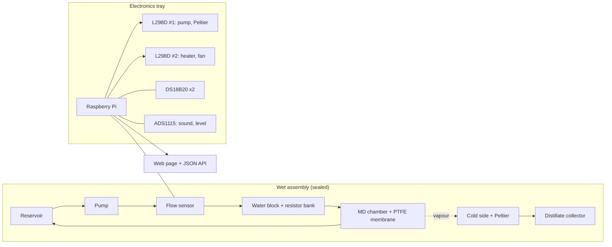

# HydroCool MD Prototype

An instrumented, closed-loop **membrane distillation (MD)** rig controlled by a Raspberry Pi. It heats a recirculating water loop, cools the permeate side with a Peltier module, and collects distillate across a hydrophobic PTFE membrane. A controller enforces safety interlocks locally, logs every run to CSV, and serves a small remote-control page.

> **Status:** hardware loop built and running; controller, logging and remote page implemented. The 3D digital twin and noise-adaptive control are in development (see [Roadmap](#roadmap)).

---

## Contents
- [How it works](#how-it-works)
- [Features](#features)
- [System architecture](#system-architecture)
- [Hardware](#hardware)
- [Wiring summary](#wiring-summary)
- [Safety interlocks](#safety-interlocks)
- [Repository layout](#repository-layout)
- [Getting started](#getting-started)
- [Configuration](#configuration)
- [Remote control and API](#remote-control-and-api)
- [Testing procedure](#testing-procedure)
- [Results](#results)
- [Known limitations](#known-limitations)
- [Roadmap](#roadmap)
- [License](#license)

---

## How it works

Membrane distillation uses a temperature difference across a hydrophobic microporous membrane. Liquid water is held back by the membrane, while water vapour crosses it, driven by the vapour-pressure difference between the hot and cold sides. Dissolved solids and particulates stay behind.

```
Hot loop (recirculating):
  Reservoir -> Pump -> Flow sensor -> Water block (heated by resistor bank) -> MD chamber (hot side) -> Reservoir

Vapour path (separate):
  Hot side -> PTFE membrane -> cold side (cooled by Peltier) -> condenses -> distillate collector
```

- **Heat in:** a resistor bank on a heat sink warms the water block, and the water carries the heat to the membrane.
- **Heat out:** the Peltier cold face keeps the condensation side cold. Its hot face must be cooled by a heat sink and fan, or the temperature difference collapses.
- **Driving force:** ΔT = T_hot − T_cold, giving a vapour-pressure difference across the membrane.

## Features

- Closed-loop water recirculation with flow confirmation before any heating
- PWM control of pump, heater, Peltier and fan through two L298D drivers
- Two DS18B20 temperature probes (hot side, cold side)
- Flow, reservoir-level and sound sensing (ADS1115 ADC for the analogue sensors)
- Local safety interlocks that work without WiFi
- CSV logging every control cycle
- Token-protected remote web page and JSON API: Start, Stop, Clear fault, setpoint slider, live readings
- Boot-on-power systemd service
- Simulation mode that runs the controller and web page on a laptop with fake hardware
- Bench scripts for every sensor and actuator

## System architecture



The wet assembly stays sealed. Power electronics and control sit outside it, joined only through a cable gland.

## Hardware

| Part | Role |
|---|---|
| Raspberry Pi (developed on a Pi 3 B+) | Controller, logger, web server |
| 2 × L298D motor driver | Switch and PWM the 12 V loads |
| 12 V submersible pump | Water recirculation |
| Resistor bank + aluminium heat sink + water block | Heat source |
| TEC1-12706 Peltier module + heat sink + fan | Cold side / condensation |
| PTFE hydrophobic membrane, polycarbonate chamber | MD chamber |
| 2 × DS18B20 | Hot-side and cold-side temperature |
| YF-S201 type flow sensor | Flow rate / circulation check |
| ADS1115 ADC | Reads sound and reservoir-level sensors |
| Analogue sound sensor, reservoir-level sensor | Diagnostics and dry-run protection |
| 12 V adapter, inline fuse, buck converter (optional) | Power |
| Reservoir, distillate collector, silicone tubing, cable gland | Fluid handling |

## Wiring summary

Full details, including the load-side wiring, are in [`docs/WIRING.md`](docs/WIRING.md).

| Function | Pi pin (BCM) | Goes to |
|---|---|---|
| Pump | GPIO18 | L298D #1 ENA |
| Peltier | GPIO13 | L298D #1 ENB |
| Heater (resistor bank) | GPIO12 | L298D #2 ENA |
| Fan | GPIO19 | L298D #2 ENB |
| Temperature probes (1-Wire) | GPIO4 | DS18B20 data, with 4.7 kΩ pull-up to 3.3 V |
| Flow sensor pulses | GPIO17 | Flow sensor signal (use a divider if its signal is 5 V) |
| ADC (I²C) | GPIO2 (SDA), GPIO3 (SCL) | ADS1115 (A0 sound, A1 water level) |

- All grounds (Pi, 12 V supply, both drivers, sensors) must share one common point.
- Add 10 kΩ pull-down resistors from each EN pin to GND so loads stay off while the Pi boots.
- Put a fuse inline on the 12 V positive line.

> **Peltier current warning:** a TEC1-12706 can draw 4–6 A, but an L298D channel is only rated for about 2 A. Lowering the duty cycle does not fix this, because each on-pulse still carries the full current. Measure the current, and if it is above about 2 A, move the Peltier to a MOSFET module or a BTS7960 driver.

## Safety interlocks

All interlocks run on the Pi, so they keep working if WiFi drops. Any trip switches every output off and latches a **FAULT** until it is cleared.

| Condition | Action |
|---|---|
| No flow (after a startup grace period) | Heater and Peltier off, fault latched |
| Hot side above `MAX_HOT` | All outputs off, fault latched |
| Reservoir level below `WATER_MIN` | All outputs off, fault latched |
| Repeated sensor read failures | All outputs off, fault latched |

The heater and Peltier only run while flow is confirmed. Remote commands are limited to Start, Stop, Clear fault and a setpoint that is clamped to a fixed range. There is no raw pin control.

## Repository layout

```
.
├── md_chamber_control.py   # controller, interlocks, logging, web page and API
├── config.py               # every tunable value: probe ids, limits, duties, pins
├── .env.example            # copy to .env and set MD_TOKEN
├── scripts/                # bench tests: probes, sensors, drivers, PWM, heater, all_off
├── deploy/                 # systemd service + install.sh
├── docs/                   # SETUP, TESTING, WIRING, REMOTE
└── logs/                   # CSV run logs (git-ignored)
```

## Getting started

### Try it without hardware
```bash
pip install flask
MD_SIMULATE=1 python3 md_chamber_control.py
```
Open http://localhost:8000 and use the token `test`.

### On the Raspberry Pi
```bash
git clone https://github.com/<your-username>/<repo-name>.git
cd <repo-name>
```
1. Follow [`docs/SETUP.md`](docs/SETUP.md) to enable I²C and 1-Wire and to install libraries.
2. Work through [`docs/TESTING.md`](docs/TESTING.md) in order. Stop and fix anything that fails before moving on.
3. Fill in `config.py`: `HOT_ID`, `COLD_ID`, `WATER_MIN`, `MIN_FLOW_LMIN`.
4. Install the service:
   ```bash
   bash deploy/install.sh
   ```
   The script prints your access token. Open `http://<pi-ip>:8000` and paste it.
5. After a successful leak test, set `MD_AUTO_START=1` in `.env` if you want the rig to start itself on power-up. It is off by default so the rig never heats on its own before you have verified it.

## Configuration

Everything you are likely to tune is in [`config.py`](config.py):

| Setting | Meaning |
|---|---|
| `HOT_ID`, `COLD_ID` | DS18B20 ids, without the `28-` prefix |
| `TARGET_HOT` | Default hot-side setpoint (°C) |
| `SETPOINT_MIN`, `SETPOINT_MAX` | Clamp for remote setpoints |
| `MAX_HOT` | Hard over-temperature cutoff |
| `WATER_MIN` | Raw ADS1115 level value below which the reservoir counts as low |
| `FLOW_FACTOR` | Flow sensor calibration (7.5 is typical for a YF-S201; check yours) |
| `MIN_FLOW_LMIN` | Below this the loop counts as "no flow" |
| `PUMP_DUTY`, `HEATER_DUTY`, `PELTIER_DUTY`, `FAN_DUTY` | Output duty cycles (0–1) |
| `LOOP_S` | Control and logging interval in seconds |

Secrets such as `MD_TOKEN` live in `.env` and are never committed.

## Remote control and API

The page at `/` offers Start, Stop, Clear fault, a setpoint slider and live readings. Remote access is meant to run over a private network such as Tailscale (see [`docs/REMOTE.md`](docs/REMOTE.md)). Do not expose the port to the open internet.

All endpoints need the header `X-Token: <your token>`.

| Method | Endpoint | Purpose |
|---|---|---|
| GET | `/api/status` | Latest readings, state, fault, target, flow state, per-device duty, limits |
| POST | `/api/start` | Start the run |
| POST | `/api/stop` | Stop the run |
| POST | `/api/clear` | Clear a latched fault |
| POST | `/api/setpoint` | Body `{"value": <°C>}`, clamped to the configured range |

## Testing procedure

[`docs/TESTING.md`](docs/TESTING.md) is a tick-box checklist:

1. Both temperature probes detected
2. Pre-power checklist (fuse, continuity, resistor value, common ground)
3. PWM test of each output, one at a time
4. Peltier polarity check
5. Heater test with a temperature cutoff
6. Full control run with logging
7. Leak test with the loop running for 15+ minutes

## Results

Fill this section from your own run logs. Keep the raw CSV files so anyone can check the numbers.

| Quantity | Value | Notes |
|---|---|---|
| Hot-side temperature | | |
| Cold-side temperature | | |
| ΔT | | |
| Flow rate | | |
| Run duration | | |
| Distillate volume | | Measured in a graduated cylinder |
| Distillate rate (mL/min) | | |
| Membrane area (cm²) | | Needed to compute flux |
| Flux (L/m²·h) | | |
| Electrical power (W) | | Measured, not estimated |
| Energy per litre (kWh/L) | | |

As a sanity check, evaporating 1 g of water needs about 2.26 kJ. The heat your rig carries into evaporation can never exceed the electrical power you put in.

## Known limitations

- Prototype scale: output is millilitres per minute, and it is not a production design.
- A simple resistor-heated, Peltier-cooled loop is not energy-efficient. Energy per litre is high compared with MD systems that recover heat internally.
- Temperature measurements are at the loop, not at the membrane surface, so temperature polarization is not captured.
- The sound sensor gives a coarse analogue reading, not a calibrated dB value.
- Flow factor and the no-flow threshold must be calibrated to your own loop.

## Roadmap

- [ ] Peltier current measurement and a higher-current driver
- [ ] Power measurement (for example an INA219 on the 12 V line)
- [ ] Distillate volume logging
- [ ] Noise-adaptive control (reduce pump and fan duty above a noise threshold while holding ΔT)
- [ ] Characterize flux and energy per litre across ΔT and flow rate
- [ ] 3D digital twin: live mirror of the rig, a fitted model with predicted-versus-measured comparison, and a data-center scale-up view
- [ ] Optional cloud logging

## License

MIT. See `LICENSE`.