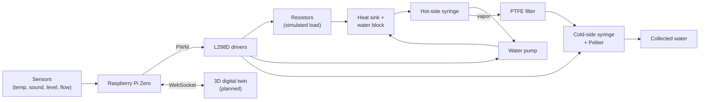

# HydroCool

**A closed-loop, noise-adaptive cooling prototype that turns a data center's waste heat into recovered water, with a live 3D digital twin (planned).**

[](LICENSE)


HydroCool is a low-cost, student-built hardware prototype. Resistors stand in for server heat, a closed water loop carries that heat to a membrane-distillation stage, and a Raspberry Pi adjusts pump, fan and Peltier power so the system stays as quiet as it can while staying cool. A browser-based 3D "digital twin" of a data center will mirror the live hardware and let you control it by clicking on components.

> **Project status, stated plainly:** the hardware design, bill of materials and build documentation are complete and parts have been sourced. The control firmware and the dashboard have **not been written yet**, and there are **no measured water-yield or noise results yet**. Targets in this README come from the [PRD](docs/prd.md) and are goals, not results.

## Table of contents

- [What the project does](#what-the-project-does)
- [Why it is useful](#why-it-is-useful)
- [Architecture](#architecture)
- [Repository layout](#repository-layout)
- [Getting started](#getting-started)
- [Status and roadmap](#status-and-roadmap)
- [Where to get help](#where-to-get-help)
- [Who maintains and contributes](#who-maintains-and-contributes)
- [License and acknowledgements](#license-and-acknowledgements)

## What the project does

The prototype has three cooperating parts:

1. **Heat to water (wet side).** Three 25 W ceramic power resistors act as a controllable "server load". They sit under an aluminium heat sink and water block. A 12 V pump circulates water through the block and into a hot-side syringe. Some of that water evaporates, the vapor crosses a hydrophobic PTFE syringe-filter membrane (which blocks liquid water and dissolved salts), and it condenses on a Peltier-cooled cold-side syringe. The condensate is collected as output water.
2. **Adaptive control.** A Raspberry Pi Zero reads temperature, noise, water level and flow sensors, then sets pump, fan, Peltier and resistor power through L298D motor drivers. The goal is the lowest fan and pump speed that still holds a safe temperature.
3. **Digital twin (planned).** A Three.js scene shows a small data center whose rack colours, fan speed, water tank and noise gauge follow the real sensor values. Clicking a component opens a panel where you can change its settings. A hard safety ceiling always overrides manual commands.

## Why it is useful

Data centers use large amounts of water for evaporative cooling and produce constant fan and pump noise near homes. Both are now the subject of lawsuits, settlements and regulation. HydroCool is a small, affordable, demonstrable model of an alternative: keep the cooling water in a closed loop and use the waste heat to make water instead of wasting it.

**Key features**

- Closed cooling loop with no evaporative loss from the main loop.
- Waste-heat-driven membrane distillation using a PTFE syringe-filter chamber. Several units can run in parallel to increase membrane area.
- Noise-aware control: slows pumps and fans whenever temperature allows, and logs dB so a quieter-than-fixed-speed result can be demonstrated against a baseline.
- Repeatable, adjustable heat load from resistors, so a demo can step between low, medium and high load on demand.
- A full, beginner-oriented build guide, wiring guide and bill of materials.
- Out-of-pocket cost of roughly ₹3,700 to ₹4,500 when common parts (Pi Zero, sensors, motor drivers, resistors, bench tools) are borrowed from a college lab.

**What it is not.** It is a proof of concept. Membrane distillation for data center water recovery is still an emerging idea; today the dominant industrial use of data center waste heat is district heating. At prototype scale the water yield from a 25 mm filter disc is expected to be small. See [Path to real-world scale](docs/prd.md#14-path-to-real-world-scale) for what would change in a real facility (industrial chiller in place of the Peltier, membrane arrays, real server racks).

## Architecture

Nodes link to the files that document them. GitHub does not render Mermaid `click` links, so on github.com use the table below the diagram; in the [Mermaid Live Editor](https://mermaid.live), GitLab or a docs site the nodes are clickable. The full diagram is in [`docs/architecture.md`](docs/architecture.md).



| Part of the system | Where it is documented |
|---|---|
| Heat source, wet side, MD stage, enclosure | [`docs/hardware-construction.md`](docs/hardware-construction.md) |
| Pin-level wiring and power | [`docs/hardware-wiring.md`](docs/hardware-wiring.md) |
| Control loop (planned) | [`firmware/README.md`](firmware/README.md) |
| Digital twin (planned) | [`dashboard/README.md`](dashboard/README.md) |
| Requirements, scope, risks | [`docs/prd.md`](docs/prd.md) |
| Budget and timeline | [`docs/project-proposal.md`](docs/project-proposal.md) |
| Phase-by-phase plan | [`docs/execution-plan.md`](docs/execution-plan.md) |

## Repository layout

```text
hydrocool/
├── README.md
├── LICENSE
├── CONTRIBUTING.md
├── docs/
│   ├── architecture.md          # full interactive Mermaid diagram
│   ├── hardware-construction.md # what each part does, build steps, real-world mapping
│   ├── hardware-wiring.md       # GPIO pins, power, sensor wiring
│   ├── prd.md                   # product requirements
│   ├── project-proposal.md      # problem, components, budget, timeline
│   └── execution-plan.md        # phase-by-phase build and test plan
├── firmware/                    # Pi control loop (planned)
└── dashboard/                   # 3D digital twin (planned)
```

## Getting started

There is no software to install yet. Getting started today means building and bench-testing the hardware.

### 1. Gather the parts

| Group | Parts |
|---|---|
| Controller and electronics | Raspberry Pi Zero (WiFi variant recommended), power adapter, 16 GB SD card, 2x L298D motor driver modules, ADS1115 ADC, DC-DC converter, breadboard and jumper wires (male-female and female-female), 4.7 kΩ resistor, inline fuse and holder, 12 V power adapter |
| Sensors | 2x DS18B20 waterproof probes, sound detection sensor, water level sensor, water flow sensor |
| Heat source | 3x 25 W ceramic power resistors, 40x40x20 mm aluminium heat sink, thermal paste |
| Wet side | Aluminium water block, 12 V submersible pump, 6 mm ID / 8 mm OD silicone tubing, 2 syringes (luer-lock), PTFE hydrophobic syringe filter |
| Cold side | TEC1-12706 Peltier module, 40 mm heat sink, 12 V 4010 fan |
| Enclosure and acoustics | 280x190x130 mm ABS box, acoustic foam, rubber vibration pads, PG7 cable glands, aquarium-safe silicone sealant, M3 hardware kit, spray adhesive |

The full list with search terms and what to check before buying is in [`docs/project-proposal.md`](docs/project-proposal.md) and [`docs/hardware-construction.md`](docs/hardware-construction.md).

### 2. Build the hardware

Follow [`docs/hardware-construction.md`](docs/hardware-construction.md) in order: stack the heat source bottom to top (resistors, paste, heat sink, paste, water block), plumb the single loop (pump → water block → hot-side syringe → back to pump), screw the PTFE filter onto the syringe tip, and mount the cold-side syringe against the Peltier. **Leak-test the loop with water running for at least 15 minutes before powering the resistors.**

### 3. Wire the electronics

Follow [`docs/hardware-wiring.md`](docs/hardware-wiring.md). Two rules matter most: the Pi and the 12 V supply are separate power systems but **their grounds must be joined**, and any 5 V sensor signal into a Pi GPIO pin needs a voltage divider because the Pi's pins are 3.3 V only.

### 4. Prepare the Pi

Flash Raspberry Pi OS to the SD card, boot, then enable the buses the sensors use:

```bash
sudo raspi-config nonint do_i2c 0       # ADS1115
sudo raspi-config nonint do_onewire 0   # DS18B20
sudo reboot
```

### 5. Bring-up checks

Confirm each subsystem on its own before running anything together.

Temperature probes (each DS18B20 appears as a `28-...` device):

```bash
ls /sys/bus/w1/devices/
cat /sys/bus/w1/devices/28-*/w1_slave
```

Pump speed through the driver's enable pin (GPIO18 per the wiring guide). Start with the pump submerged and the loop filled:

```python
from time import sleep
from gpiozero import PWMOutputDevice

pump = PWMOutputDevice(18)
for duty in (0.3, 0.6, 1.0, 0.0):
    pump.value = duty
    print(f"pump duty {duty:.0%}")
    sleep(5)
```

I2C devices (the ADS1115 usually shows at address `0x48`):

```bash
sudo apt install -y i2c-tools
i2cdetect -y 1
```

Before applying resistor power, check that the Peltier's cold face is the face against the cold-side syringe (an infrared thermometer is ideal), and never swap its polarity afterwards.

### Safety

- Resistors and the heat sink get hot. Use heat-safe surfaces and do not touch the stack while powered.
- Keep electronics out of any splash zone. Use an inline fuse on the 12 V supply.
- Do not run the pump dry, and do not force liquid through the membrane by pressurising the hot-side syringe.

## Status and roadmap

| Area | Status |
|---|---|
| Requirements, scope and risks ([PRD](docs/prd.md)) | Done |
| Bill of materials and parts sourcing | Done (a few small items still to buy) |
| Build and wiring documentation | Done |
| Hardware build and leak testing | Not started |
| Control firmware | Planned |
| Digital twin dashboard | Planned |
| Measured results (water yield, noise, temperature, salinity) | Not started |

**Targets from the PRD** (not yet achieved): measurable condensate output (aspirationally 20 to 50 mL per hour, which may need several syringe-filter units in parallel), operating noise at or below 55 dB at 1 m, and dashboard lag under 1 to 2 seconds.

## Where to get help

- **Build questions:** start with [`docs/hardware-construction.md`](docs/hardware-construction.md) and [`docs/hardware-wiring.md`](docs/hardware-wiring.md).
- **Why a design decision was made:** see [`docs/prd.md`](docs/prd.md), including the risks table and the path-to-scale section.
- **Bugs, wiring mistakes or unclear steps:** open an issue in this repository's issue tracker with a photo and the exact part listing you used.
- **Planned software:** see [`firmware/README.md`](firmware/README.md) and [`dashboard/README.md`](dashboard/README.md).

## Who maintains and contributes

HydroCool is maintained by **[Your Name / Team Name]**, [Your University], as a 3rd-year engineering project. Replace this line with your team and a public contact (a GitHub profile or a project email you are comfortable sharing).

Contributions are welcome, especially measured results and firmware. Read [`CONTRIBUTING.md`](CONTRIBUTING.md) first.

## License and acknowledgements

Released under the MIT License. See [`LICENSE`](LICENSE).

The heat-to-water idea was inspired by a hackathon project named Drip, which used a Raspberry Pi 5 and a membrane-distillation chamber. HydroCool differs in adding noise-adaptive control, a controllable heat load, and a digital twin.
